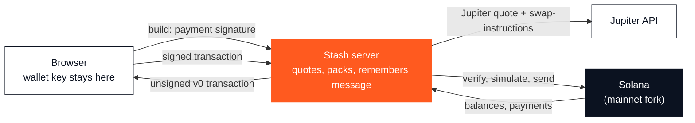
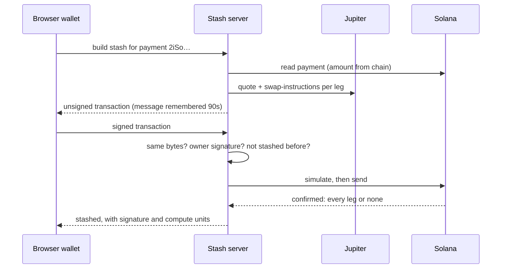

<a id="top"></a>

<h1 align="center">Stash</h1>

<p align="center">
  <strong>Get paid in dollars. Keep some of it in stocks.</strong><br>
  Set a rule once. Every payment you receive buys your basket, in one transaction, any day of the week.
</p>

<p align="center">
  <a href="#x-running-it">Run it locally</a>
  &nbsp; · &nbsp;
  <a href="#xi-what-is-true-and-what-is-not">What works today</a>
  &nbsp; · &nbsp;
  <a href="https://hack.dev3pack.xyz">Dev3pack Global Hackathon ↗</a>
</p>

<p align="center">
  <sub>SOLANA &nbsp; / &nbsp; TOKEN-2022 xSTOCKS &nbsp; / &nbsp; JUPITER &nbsp; / &nbsp; WEB3.JS &nbsp; / &nbsp; PLAIN NODE</sub>
</p>

<p align="center"><sub>Everything below runs on a local Solana mainnet fork with fake balances. Nothing here has spent real money.</sub></p>

---

**One payment, three stocks, one transaction.**

| Basket | Size | Accounts | Compute units |
| :--- | :---: | :---: | :---: |
| 60% S&P 500, 40% Nvidia | 843 to 874 / 1,232 bytes | 35 / 64 | 136,331 to 197,578 |
| 50% S&P 500, 30% Nvidia, 20% Tesla | 1,118 / 1,232 bytes | 47 / 64 | 224,000 to 266,000 |

<sub>Measured on surfpool 1.5.0 forking Solana mainnet, 25 to 27 November 2026. Real Jupiter routes, real pools, real xStock mints; fake USDC and SOL.</sub>

> **The stock market should be where your money goes by default, not a place you apply to.**
>
> Most people paid in dollars outside the US cannot easily own a share of the S&P 500. The obstacles
> are paperwork, a funding delay measured in days, and a market that closes on Friday afternoon.
> Tokenized equities on Solana remove all three. What is missing is the habit.

| What has been observed on chain | Where the boundary is |
| :--- | :--- |
| A payment arriving, found by reading the chain, then 20% of it stashed into stocks | On a local **mainnet fork** with fake balances, not on mainnet. |
| A two- and a three-stock basket landing in **one** transaction (843 and 1,118 of 1,232 bytes) | Three stocks is the ceiling; a fourth does not fit. |
| The user's wallet signing in the browser; the server never holds the key | On the fork the wallet is a test keypair kept in the browser, not Phantom. |
| The server refusing a different transaction than it built, a replay, and a double stash | Build state lives in memory; a server restart means "build again". |
| Exactly the allocated amount leaving the wallet, and Stash's 0.5% fee arriving in the treasury | The user pays network fees in SOL; nothing sponsors them yet. |
| Selling part of a stock back to USDC, fee included | Eligibility is a confirmation the user ticks, not a verified check. |

<details>
<summary><strong>Contents</strong></summary>

| | Chapter | |
| :--- | :--- | :--- |
| 01 | [The gap](#i-the-problem) | Why dollars sit idle |
| 02 | [The promise](#ii-the-one-idea) | One rule, one tap, one transaction |
| 03 | [Architecture](#iii-the-shape) | Where truth lives |
| 04 | [The life of a stash](#iv-the-life-of-a-stash) | Detect, quote, build, sign, verify |
| 05 | [Edge cases](#v-edges) | Who can hold xStocks, and who can freeze them |
| 06 | [Getting out](#vi-getting-out) | Selling back to dollars |
| 07 | [Risk and economics](#vii-risk) | What it costs, and what it earns |
| 08 | [Engineering decisions](#viii-the-decisions) | Twelve problems and their fixes |
| 09 | [Repository map](#ix-the-map) | Where the moving parts live |
| 10 | [Run locally](#x-running-it) | Steps and troubleshooting |
| 11 | [What works today](#xi-what-is-true-and-what-is-not) | Observed, unobserved, absent |

</details>

---

<a id="i-the-problem"></a>

## 01 · The gap

You just got paid $500 in USDC for a job. You want $100 of it to grow.

The usual options and what is wrong with each:

| Option | What gets in the way |
| :--- | :--- |
| An international brokerage app | Identity checks, funding by bank wire or card, days before the money arrives, and trading only when New York is open |
| Leaving it in USDC | Safe, and it does not grow |
| Buying a token on a DEX by hand | One stock at a time, a different screen for each, and nothing that repeats |

The author's own version: second place at Stocklana paid $20,000 in USDC. Keeping part of it in an
index fund meant choosing between paperwork and doing it by hand every time. Stash is the version
that does it automatically.

<a id="ii-the-one-idea"></a>

## 02 · The promise

**Set a rule once. Each payment you receive buys your basket in one transaction.**

- **A rule, not a trade.** "20% of everything I receive: 60% S&P 500, 40% Nvidia." You decide once.
- **One tap per payment.** The whole basket fills in one transaction or not at all. You never end up holding half a basket.
- **Any day, any size.** xStocks trade 24/7, and the network fee for a stash is 5,500 lamports.

<a id="iii-the-shape"></a>

## 03 · Architecture

| Surface | What it is |
| :--- | :--- |
| `apps/web` landing (`/`) | What Stash is, how it works, the measured numbers, what is real |
| `apps/web` app (`/app`) | Dashboard: payments, rule, holdings, stash and sell drawers, activity |
| `apps/web` server | Plain Node `http`. Reads the chain, builds unsigned transactions, verifies and sends signed ones |
| `packages/core` | All domain and chain logic: allowlist, allocation, Jupiter, basket packing, payments, sell, verify |
| `packages/fork` | Fork-only helpers: cheatcodes, clock sync, route refresh, the test payer |
| `packages/scripts` | Funding and end-to-end scripts that print signatures |

**Where truth lives.** Balances, holdings and payments are read from the chain every time; the
server never stores an amount it could read. The server stores only what the chain cannot hold:
each wallet's rule, its eligibility confirmation, and which payment signatures it has already stashed
(`.stash/users/<wallet>.json`). The private key never leaves the browser.



<a id="iv-the-life-of-a-stash"></a>

## 04 · The life of a stash

| Stage | What happens |
| :--- | :--- |
| Rule | The user picks a percentage and up to three stocks adding up to 100%. Stored per wallet. |
| Detect | A USDC payment arrives. Stash finds it by reading the chain: the owner did not sign it, it succeeded, and the owner's USDC went up. The amount is never typed in. |
| Allocate | Payment × rule → one leg per stock, in integer base units. The leftover cent goes to the heaviest leg, so legs always sum to the exact amount. |
| Quote | The server quotes each leg through Jupiter with a 0.5% platform fee. The client never names a price or a mint. |
| Build | All legs go into one v0 transaction with Jupiter's lookup tables, a 500,000 compute-unit limit and a 1,000 micro-lamport priority fee. |
| Sign | The server returns it unsigned and remembers the exact message bytes for 90 seconds. The browser wallet signs. |
| Verify | `/api/submit` checks the signed message is byte-for-byte the one it built and the owner's ed25519 signature, then simulates. A changed, replayed or second stash of the same payment is refused. |
| Land | Either every stock in the basket arrives, or nothing moves. |



<details>
<summary>Why three stocks is the ceiling</summary>

A Solana transaction is at most 1,232 bytes and 64 accounts. Each Jupiter leg brings its pool
accounts; lookup tables shrink them to one byte each. Measured: two legs take 843 to 874 bytes and 35
accounts, three take 1,118 bytes and 47. A fourth leg does not fit, so the rule form allows three.
If a route ever comes out too large, packing fails with "This basket is over 1232 bytes, the most a
transaction allows. Try fewer stocks." and nothing is signed.

</details>

<a id="v-edges"></a>

## 05 · Edge cases

- **Who can hold xStocks.** Not everyone. Kraken's
  [xStocks FAQ](https://support.kraken.com/articles/xstocks-faq) says they are not accessible in
  the US or to US persons, Canada, the UK or Australia, and holding them in a self-custody wallet
  does not change that. Stash asks you to confirm before your first stash, not after.
- **xStocks are not Solana-only.** They are also issued on Ethereum, TON and Ink. An earlier draft
  of this README implied otherwise. What Stash depends on Solana for is narrower and measurable: a
  whole basket, routed by Jupiter, filled in one atomic transaction for 5,500 lamports, on a Sunday
  as easily as a Tuesday.
- **Who can freeze, pause or move them.** Read from the SPYx mint (`XsoCS1Tf…DF2W`): it has a
  freeze authority, a mint authority, a **permanent delegate**, a **pausable** config, a transfer
  hook and a default account state. The issuer can freeze or pause the token and move it out of any
  account. Stash inherits that risk and cannot remove it.
- **Look-alike tokens.** A Jupiter search for `NVDAx` returns the real mint and impostors such as
  "NVIDA xStcok". Stash never resolves a stock by name: only five hard-coded mints are accepted
  (SPYx, QQQx, NVDAx, TSLAx, AAPLx), checked again on every quote.
- **A tokenized share is a claim on a share.** It is not the share itself.

<a id="vi-getting-out"></a>

## 06 · Getting out

Sell 25%, 50% or all of a position back to USDC: one route, one transaction, signed by the user's
wallet, with Stash's 0.5% fee taken in USDC. Observed on the fork: half of an NVDAx position sold
for $248.53 against a $248.55 quote; in the app, 50% of NVDAx for $19.79 and 25% of SPYx for $14.85.

<a id="vii-risk"></a>

## 07 · Risk and economics

| Parameter | Value | Why |
| :--- | :--- | :--- |
| Platform fee | 0.5% (50 bps) per swap | Taken by Jupiter into the treasury's token account for that stock |
| Slippage | 1% (100 bps) per leg | xStock pools are thin away from US market hours; not tuned further |
| Route accounts | `maxAccounts` 20 | 12 found no route; 16 to 24 returned the same compact routes |
| Minimum leg | $1 | Below that the fee rounds to dust and network costs dominate |
| Compute limit | 500,000 units | About 2x the worst measured three-stock basket (266,000) |
| Priority fee | 1,000 micro-lamports per unit | Adds 500 lamports at the limit |

**What a $100 stash costs the user:** $0.50 to Stash, plus 5,000 lamports for the signature and up
to 500 lamports of priority fee. The first purchase of a stock also creates the user's token
account for it, whose rent deposit is paid once in SOL; that amount has not been measured here.

**What Stash earns:** $0.50 per $100 stashed, and the same on every sale. Stash pays nothing per
transaction today, because the user pays the network fee. A sponsored fee payer would move that
cost to Stash and is not built.

<a id="viii-the-decisions"></a>

## 08 · Engineering decisions

Each was hit while building, with the real error.

1. **Never trust a token name.** Jupiter search returns impostor mints named like xStocks. Fix: a
   frozen allowlist of five verified mints, re-checked on every quote and sale.
2. **`feeAccount is required for swap with platformFee`** (`NOT_SUPPORTED`) from
   `swap-instructions`. With ExactIn, Jupiter takes the fee in the output mint, so the treasury needs
   a Token-2022 account per stock. `pnpm fund` creates them.
3. **`No routes found`** at `maxAccounts=12`. xStock pools need more accounts; 20 is the default.
4. **Compute was unknown.** Simulated on the fork: 197,063 units for two stocks, 224,000 to 266,000
   for three. The limit came down from 1.4 million to 500,000.
5. **`encoding overruns Uint8Array`** from web3.js when a basket is too big. The serializer throws
   before any size check. `packBasket` catches it and says "Try fewer stocks".
6. **The "only on Solana" claim was wrong.** xStocks are also on Ethereum, TON and Ink. Every claim
   was narrowed to the one-transaction basket.
7. **GoonFi `custom program error: 0x15`** on a stash that worked an hour earlier. The fork clones
   an account once and never updates it, while Jupiter quotes live mainnet. Fix: reset every account
   the route touches just before simulating, except the accounts holding fake balances.
8. **Whirlpool `InvalidTimestamp` (6022)**, "Timestamp should be greater than the last updated
   timestamp". The fork's clock had drifted 73 minutes behind, so freshly reset pools looked as if
   they came from the future. The first fix measured drift with `getBlockTime` and was wrong (it said
   11s behind when the clock was 3s ahead). The working fix reads the Clock sysvar and time-travels
   the fork only when it is more than 10 seconds behind. Five of five three-stock stashes then
   landed.
9. **`unsafeRes.map is not a function`** in `getParsedTransactions`. The fork does not support
   batched RPC. Fix: fetch each transaction separately.
10. **Payments dated January 1970.** The fork's `getTransaction` reports block time divided by
    1,000. Fix: any impossible time is replaced with `getBlockTime(slot)`.
11. **The server used to sign.** The first app signed with a server-held key. It was rewritten so the
    browser signs and the server verifies the exact bytes it built; three cheats are now refused
    (`pnpm api`).
12. **A restarted fork left the browser wallet with 0 SOL**, so it could not pay fees. The app now
    tops a fork wallet up whenever it runs low.

<a id="ix-the-map"></a>

## 09 · Repository map

| Package | Lines | Role |
| :--- | ---: | :--- |
| `packages/core` | 1,395 | Domain and chain logic, 47 unit tests |
| `packages/fork` | 262 | Fork-only helpers |
| `packages/scripts` | 502 | Funding and end-to-end scripts |
| `apps/web/src` | 508 | Server and per-wallet store |
| `apps/web/public` | 1,066 | Landing page and app (HTML, CSS, JS) |

```text
packages/core/src
  allowlist.ts     five verified xStock mints; everything else refused
  allocation.ts    payment × rule → legs, exact to the base unit
  jupiter.ts       quote and swap-instructions, fee account per leg
  basket.ts        all legs into one v0 transaction; size and compute limits
  payments.ts      incoming USDC payments, read from the chain
  sell.ts          one stock back to USDC
  verify.ts        signed message must equal the built one; ed25519 check
  prices.ts        Jupiter prices for holdings
packages/fork/src
  surfnet.ts       cheatcodes, clock sync, route refresh; refuses any RPC that is not a surfnet
  protect.ts       accounts holding fake balances, never reset
  keys.ts          fork test keys in keys/ (gitignored)
  pay.ts           the test payer's USDC transfer
packages/scripts/src
  fund.ts  e2e-stash.ts  e2e-basket-size.ts  e2e-payment.ts  e2e-sell.ts  e2e-api.ts
apps/web
  src/server.ts    routes: state, payments, rule, eligibility, preview, build, submit
  src/store.ts     per-wallet rule and history
  public/          landing.html, app.html, app.js, style.css, landing.css
tools/             gui.ps1 (desktop GUI tests), phone-frames.html, logo-cut.py
```

### Built before vs during the hackathon

Taken from [Draw](https://github.com/Nnadijoshuac/draw), the author's earlier Solana project
(Stocklana, September 2026):

- `pnpm-workspace.yaml` and `tsconfig.base.json`.
- The approach of a surfpool mainnet fork with fake balances, and the cheatcode helper in
  `packages/fork/src/surfnet.ts`, adapted.
- The README's structure.

Everything else was written between 25 and 29 November 2026. The logo was made with Gemini.

<a id="x-running-it"></a>

## 10 · Run locally

Needs Node 20+, pnpm and [surfpool](https://github.com/txtx/surfpool) (on Windows, inside WSL).

1. `pnpm install`
2. Start the fork:
   `surfpool start --no-tui --host 0.0.0.0 --rpc-url https://api.mainnet-beta.solana.com`
   (RPC on `127.0.0.1:8899`).
3. `pnpm fund` creates the test keys in `keys/` (gitignored), the treasury's fee accounts, and fake
   SOL and USDC.
4. `pnpm --filter @stash/web dev`, then open `http://localhost:4321` (landing) or `/app`.
5. In the app: tick eligibility, set a rule, press "Simulate a payment", then "Stash".

End to end without the browser: `pnpm stash` (or `pnpm stash 3`), `pnpm payment`, `pnpm sell`, and
with the app running, `pnpm api`. Unit tests: `pnpm test`.

| Symptom | Cause | Fix |
| :--- | :--- | :--- |
| Server will not start: not a surfnet | It refuses any RPC that is not a local fork | Start surfpool first |
| Wallet shows 0 SOL after a restart | The fork forgets balances | Reload the app; it tops up. Run `pnpm fund` again |
| Custom 0x15 or 6022 in simulation | Stale fork state or clock drift | Handled before each send; if it persists, restart surfpool |
| History counts stashes holdings do not show | Saved history outlives a fork restart | Clear `.stash/` for a clean demo |

<a id="xi-what-is-true-and-what-is-not"></a>

## 11 · What works today

**Observed on a local mainnet fork** (surfpool 1.5.0, fake balances)

| What | Evidence (fork signatures) |
| :--- | :--- |
| Two-stock basket, $100, 197,063 units (script, 25 Nov) | `5q6T9X8eUTp9ec7abSnLbhhGUjoX8AyoNatvs54pHZjwhwLsevBGnkV5gCw45tGDxAda5oWPw2qP1pp8VtQ9t77u` |
| Three-stock basket, $100, 252,633 units (script, 25 Nov) | `59DdfM4dozHF3XSwRd5xLEDRRvvBHsty6vTbQbqUE4YiNDoXH6jS21SiUHGjJGX6ynTxkL5xLg5DupUHC3qe32w6` |
| Payment detected and stashed in the app, browser-signed, 197,578 units (27 Nov) | `2iSopxoQoEkMxmeqGhGnNPFkFNoT2NaWuf84UdGSDZF5NMA8rxPY1EHj1nZhuq4WEK4AK6dUkrX4TanrPQETAKep` |
| Sold 50% of NVDAx in the app for $19.79 (27 Nov) | `y9Jn1sbYVxecJwiYDYYgR7riV2w15a9CqbQ9m6fM6pWCJ7FnGLggweNhL7pLi232eDYt9z2jwTWe4pvNqY2GvKu` |
| Sold 25% of SPYx in the app at phone width for $14.85 (27 Nov) | `3XEXSGqxRygPzef22fnXpb5LyErkRMxbxeDeyLsvh9KWv6sBKduVSoHwM1zcnhLJkygvqMkgjvhDZ4Ns7m6EYKHV` |
| Three cheats refused: a different transaction under the same build, a replayed build, a second stash of one payment | `pnpm api` |

The stash and sell drawers were tested on screen at desktop width and at about 740px, the narrowest
a desktop browser window goes. Unit tests: 47, on the allowlist, allocation, fee accounts, basket
packing, payments, selling and signature verification (`pnpm test`).

**Built, not observed end to end**

- Nothing on mainnet. Every observation above is on the fork.

**Deliberately absent**

- Mainnet deployment. The owner's rule for this build is zero real-money cost.
- A fiat on-ramp or off-ramp. Stash starts from USDC already in the wallet.
- Investment advice. The user chooses the basket.

**Open work**

- Phantom or another real wallet in place of the fork's browser test wallet.
- A fee sponsor, so a user with no SOL can still stash.
- Automatic stashing without a tap, which needs a delegated or session key.
- A verified eligibility check in place of a tick box.

---

<p align="center">
  <strong>Get paid. Keep some.</strong><br>
  <sub>Built for the <a href="https://hack.dev3pack.xyz">Dev3pack Global Hackathon ↗</a></sub>
</p>
