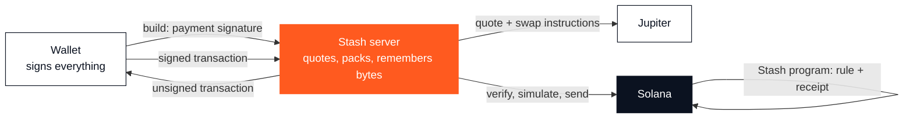
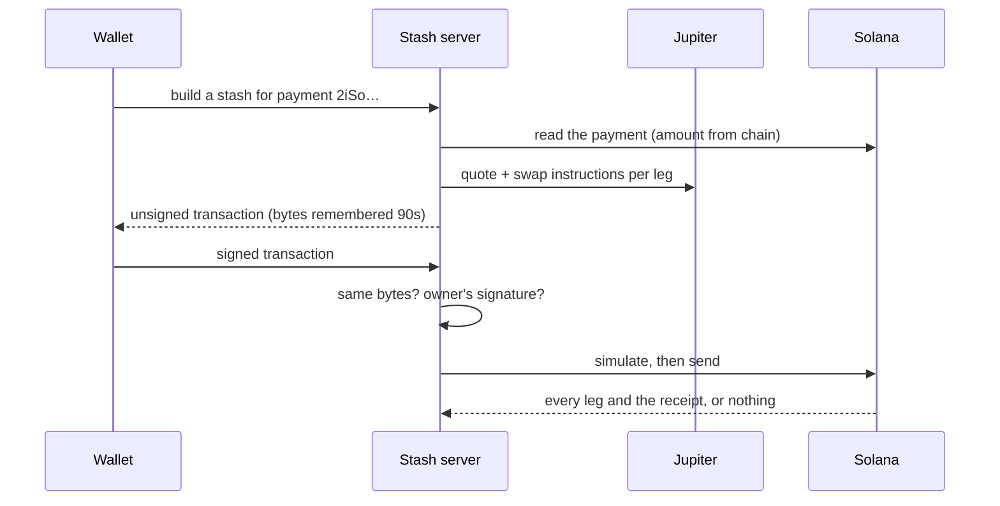

<h1 align="center">Stash</h1>

  <strong>Invest a slice of every payment.</strong> 
  Set a rule once. When money lands in your wallet, one tap puts a slice of it into stocks, in one transaction.

  <a href="https://stash-drab-gamma.vercel.app/app">Try it on devnet ↗</a>
  &nbsp; · &nbsp;
  <a href="https://stash-drab-gamma.vercel.app/stash.apk">Android APK ↗</a>
  &nbsp; · &nbsp;
  <a href="#10-run-locally">Run it locally</a>
  &nbsp; · &nbsp;
  <a href="#11-what-works-today">What works today</a>
  &nbsp; · &nbsp;
  <a href="https://hack.dev3pack.xyz">Dev3pack Global Hackathon ↗</a>

  SOLANA &nbsp; / &nbsp; ANCHOR &nbsp; / &nbsp; TOKEN-2022 xSTOCKS &nbsp; / &nbsp; JUPITER &nbsp; / &nbsp; MOBILE WALLET ADAPTER &nbsp; / &nbsp; EXPO

Program <code>7G66DnGnvPBaAr4hWNhno1ZDeAuh2bvcFmKm5UiZu7oJ</code> is deployed on devnet. The live app and the Android app run against it. The stock swaps need real xStock pools, which only exist on mainnet, so that part runs on a local mainnet fork with fake balances. Nothing here has spent real money.

---

**Every stock in your basket fills or none does, and Solana itself refuses to stash the same payment twice.**

| What the program enforces | Checked on devnet (28 Nov) |
| :--- | :--- |
| A rule can only name verified xStocks, one or two of them, adding up to 100% | `UnverifiedStock` (6002) on a random mint |
| The stashed amount is exactly the rule's share of the payment, rounded down | `AmountBreaksRule` (6006) on $150 of $500 at 20% |
| One receipt per payment, so a payment can be stashed once | second stash fails: receipt address "already in use" |
| The receipt is written in the same transaction as the swaps | if a swap fails, there's no receipt and nothing moves |

Run it yourself: <code>pnpm devnet</code>. Signatures are in <a href="#11-what-works-today">What works today</a>.

> **Investing should happen when money arrives, not when you remember.**
>
> A salary can invest for you before you see it. Freelancers, creators and anyone paid in lumps
> don't get that: the money lands, bills come first, and investing moves to next month. Tokenized
> stocks on Solana can be bought from a wallet, any day, in amounts as small as a dollar. What's
> missing is the habit, and a guarantee that the habit can't go wrong.

| What has been observed | Where the boundary is |
| :--- | :--- |
| The Stash program on devnet: rules saved, stashes recorded, double stashes and wrong amounts refused | Devnet has no xStocks, so on devnet the slice goes to a USDC account the wallet owns instead of into stocks |
| A two-stock basket bought with real Jupiter routes, plus the receipt, in one transaction of 1,002 / 1,232 bytes | On a local mainnet fork with fake balances, not on mainnet |
| The Android app connecting and signing through Mobile Wallet Adapter | Payments are checked every 15 seconds while the app is open; there's no push server yet |
| The wallet signs every transaction; the server never holds a key | You still tap once per payment. Stashing with no tap needs a limited session key, which isn't built |

<strong>Contents</strong>

| | Chapter | |
| :--- | :--- | :--- |
| 01 | [The gap](#01-the-gap) | Who it's for and why existing options fail |
| 02 | [The promise](#02-the-promise) | One rule, one tap, one transaction |
| 03 | [Architecture](#03-architecture) | Where truth lives |
| 04 | [The program](#04-the-program) | What runs on chain and what it refuses |
| 05 | [The life of a stash](#05-the-life-of-a-stash) | Detect, quote, build, sign, verify |
| 06 | [On your phone](#06-on-your-phone) | The Android app and the devnet web app |
| 07 | [Risks you inherit](#07-risks-you-inherit) | Who can hold xStocks, and who can freeze them |
| 08 | [Money](#08-money) | What it costs, what it earns, what's next |
| 09 | [Engineering decisions](#09-engineering-decisions) | Problems hit while building, and the fixes |
| 10 | [Run locally](#10-run-locally) | Steps and troubleshooting |
| 11 | [What works today](#11-what-works-today) | Observed, not observed, absent |

---

## 01 · The gap

**Who it's for.** People paid in stablecoins in uneven lumps: freelancers, creators, contractors.
A designer in Lagos paid $500 in USDC by a client abroad is a good example. She wants $100 of it
in the S&P 500. Her choices today:

| Option | What gets in the way |
| :--- | :--- |
| A brokerage app | Identity checks, funding by wire or card, days before the money arrives, trading only when New York is open. From many countries, not available at all |
| Keep it in USDC | Safe, and it doesn't grow |
| Buy a tokenized stock on a DEX by hand | One stock at a time, a new screen each time, and nothing that repeats |

The last option is close. The pieces exist: xStocks track the S&P 500, Nvidia and others; Jupiter
routes USDC into them; wallets hold them. Nobody had tied them to the moment money arrives.

## 02 · The promise

**Set a rule once. Each payment you receive buys your basket in one transaction.**

- **A rule, not a trade.** "20% of everything I receive: 60% S&P 500, 40% Nvidia." It lives on chain, and only your wallet can change it.
- **One tap per payment.** The whole basket fills in one transaction or not at all. You never hold half a basket, and the same payment can't be stashed twice.
- **Any day, any size.** xStocks trade around the clock, and the network fee for a stash is 5,500 lamports.

**Why Solana.** A whole basket, routed through Jupiter, plus the program's receipt, fits in one
atomic transaction (1,002 of 1,232 bytes for two stocks). That's what makes "all or nothing"
true. It costs a fraction of a cent, and it works on a Sunday.

## 03 · Architecture

| Surface | What it is |
| :--- | :--- |
| `programs/stash` | Anchor program: the rule and a receipt per stashed payment |
| `apps/web` | Landing page, the full app (`/app` locally), and a plain Node server that builds unsigned transactions and verifies signed ones |
| `apps/mobile` | Android app (Expo, Mobile Wallet Adapter) on devnet. Its `web/` folder is the same client in a browser, served at `/app` on the live site |
| `packages/core` | Domain and chain logic: allowlist, allocation, Jupiter, basket packing, payments, sell, verify, program client |
| `packages/fork` | Fork-only helpers: cheatcodes, clock sync, route refresh |
| `packages/scripts` | Funding and end-to-end scripts that print signatures |

**Where truth lives.** On chain: the rule (`["rule", owner]`), one receipt per stashed payment
(`["stash", owner, payment id]`), balances, holdings, payments. The server keeps nothing it could
read from the chain except a 90-second memory of the transactions it built, and an eligibility tick
per wallet. The private key never leaves the wallet.

## 04 · The program

`programs/stash/src/lib.rs`, Anchor 0.32.1, 227 lines. Devnet address
[`7G66DnGnvPBaAr4hWNhno1ZDeAuh2bvcFmKm5UiZu7oJ`](https://explorer.solana.com/address/7G66DnGnvPBaAr4hWNhno1ZDeAuh2bvcFmKm5UiZu7oJ?cluster=devnet).

| Instruction | Accounts | What it checks |
| :--- | :--- | :--- |
| `set_rule(stash_bps, basket)` | owner (signer), rule PDA `["rule", owner]` | 1 to 10,000 bps; one or two stocks; each one of five verified xStock mints; no duplicates; weights above zero and summing to 10,000 |
| `record_stash(payment_id, payment_usdc, stash_usdc)` | owner (signer), rule PDA, receipt PDA `["stash", owner, payment_id]` | the rule exists and belongs to the signer; `stash_usdc == floor(payment_usdc × stash_bps / 10,000)`; the receipt is `init`, so a second one for the same payment fails |

The payment id is the first 32 bytes of the payment's transaction signature. The program doesn't
read the payment itself; the client finds it on chain and the program checks the arithmetic. It
emits a `Stashed` event with the amounts.

Errors, as a user would read them:

| Code | Message |
| :---: | :--- |
| 6000 | Choose how much of each payment to stash: more than 0% and at most 100%. |
| 6001 | A basket holds one or two stocks, so it fits in one transaction. |
| 6002 | Only verified xStocks can be stashed into. |
| 6003 | Every stock in the basket needs a share above 0%. |
| 6004 | Each stock can appear in the basket only once. |
| 6005 | The basket's shares must add up to 100%. |
| 6006 | The stashed amount is not what the rule says for this payment. |

Tests: 3 Rust unit tests on the rule checks and rounding (`cargo test`), 6 TypeScript tests on the
instruction encoding (`packages/core/src/program.test.ts`, including one that pins the
discriminators the Android app writes by hand), and `pnpm devnet` against the deployed program.

## 05 · The life of a stash

| Stage | What happens |
| :--- | :--- |
| Rule | The wallet signs `set_rule`. The app reads it back from chain; there's no other copy. |
| Detect | A USDC payment arrives. It counts if it succeeded, the wallet's USDC went up, and the wallet didn't sign it. The amount comes from the chain, never from a form. |
| Allocate | Payment × rule → one leg per stock, in base units. The leftover unit goes to the heaviest leg, so legs sum exactly. |
| Quote | The server quotes each leg through Jupiter with a 0.5% platform fee. The client never names a price or a mint. |
| Build | Swap legs plus `record_stash` go into one v0 transaction with Jupiter's lookup tables. |
| Sign | The server returns it unsigned and remembers the exact message bytes for 90 seconds. The wallet signs. |
| Verify | The server checks the signed message is byte for byte the one it built and that the owner signed it, then simulates and sends. |
| Land | Every stock arrives and the receipt is written, or nothing happens. |

Why two stocks is the limit

A transaction is at most 1,232 bytes and 64 accounts. Each Jupiter leg brings its pool accounts;
lookup tables shrink them to one byte each. Measured on the fork on 27 November: two legs take
843 bytes, and 1,002 with the receipt. Three legs without the receipt came to 1,095, 1,117, 1,159
and once 1,261 bytes, so three legs plus the receipt never fit. The program, the server and both
apps cap the basket at two. An earlier version of this README advertised three; that was before
the receipt existed.

Selling back to USDC

Sell 25%, 50% or all of a position: one route, one transaction, signed by the wallet, with the 0.5%
fee taken in USDC. Observed on the fork: 50% of NVDAx for $19.79 and 25% of SPYx for $14.85.

## 06 · On your phone

**Android app** (`apps/mobile`). Started from Solana Mobile's official `expo-web3js-minimal`
template. It connects and signs through Mobile Wallet Adapter, so any MWA wallet works (Solflare,
Phantom, or the Fake Wallet on an emulator). On devnet it:

1. saves your rule on chain with `set_rule`;
2. checks for USDC payments every 15 seconds and puts a notification on the phone with the slice it would stash;
3. stashes in one transaction: moves the slice into a second USDC account your wallet owns, and `record_stash` writes the receipt;
4. moves stashed USDC back when you ask.

Why a phone: payments arrive when you're not at a desk, and the notification is the moment the
habit happens.

**Web, on devnet** ([stash-drab-gamma.vercel.app/app](https://stash-drab-gamma.vercel.app/app)).
The same client code in a browser, with any Wallet Standard wallet. "Send me a test payment" makes
a test client pay you $2 of devnet USDC (and a little SOL for fees), so you can try the full loop in
a minute.

Devnet has no xStocks and no Jupiter, so neither of these buys stock. The stock purchase is the web
app on the mainnet fork ([Run locally](#10-run-locally)).

## 07 · Risks you inherit

- **Who can hold xStocks.** Not everyone. Kraken's [xStocks FAQ](https://support.kraken.com/articles/xstocks-faq) says they aren't available to US persons or in Canada, the UK or Australia, and holding them in a self-custody wallet doesn't change that. Stash asks you to confirm before your first stash.
- **Who can freeze them.** The SPYx mint has a freeze authority, a permanent delegate and a pausable config. The issuer can freeze or pause the token and move it out of any account. Stash can't remove that risk.
- **Look-alike tokens.** Searching Jupiter for `NVDAx` returns impostors such as "NVIDA xStcok". Stash never looks a stock up by name: five mints are hard-coded in the program and in the client.
- **xStocks aren't Solana-only.** They also exist on Ethereum, TON and Ink. What Stash needs Solana for is narrower: the whole basket and its receipt, atomically, for 5,500 lamports.
- **A tokenized share is a claim on a share,** not the share itself.

## 08 · Money

| Parameter | Value | Why |
| :--- | :--- | :--- |
| Platform fee | 0.5% per swap | Taken by Jupiter into the treasury's account for that stock |
| Slippage | 1% per leg | xStock pools are thin outside US market hours |
| Route accounts | `maxAccounts` 20 | 12 found no route; 16 to 24 gave the same routes |
| Minimum leg | $1 | Below that, the fee rounds to dust |
| Compute limit | 500,000 units | About 2.5x the worst measured two-stock basket (197,578) |

**What a $100 stash costs the user:** $0.50 to Stash, 5,000 lamports for the signature, up to 500
lamports of priority fee, and on the first stash the rent for the receipt and any new token account.

**What Stash earns:** $0.50 per $100 stashed, and the same on every sale. It pays nothing per
transaction today because the user pays the network fee.

**Next, in order:** mainnet with a small allowlist of users; a limited session key so a stash can
happen with no tap, signed by a key that can only call `record_stash` and swap into the rule's
stocks; a fee sponsor so a wallet with no SOL can stash; a USDC on-ramp for people who are paid in
local currency.

## 09 · Engineering decisions

Each one was hit while building, with the real error.

1. **Never trust a token name.** Jupiter search returns impostor mints. Fix: five verified mints, hard-coded in the program and re-checked on every quote.
2. **`feeAccount is required for swap with platformFee`.** With ExactIn, Jupiter takes the fee in the output mint, so the treasury needs a Token-2022 account per stock. `pnpm fund` creates them.
3. **`No routes found` at `maxAccounts=12`.** xStock pools need more accounts; 20 works.
4. **The receipt broke the three-stock basket.** Adding `record_stash` cost 159 bytes. Three legs plus the receipt measured over 1,232 bytes. The basket is now capped at two everywhere, including in the program.
5. **`encoding overruns Uint8Array`** from web3.js when a basket is too big; it throws before any size check. `packBasket` catches it and says "Try fewer stocks".
6. **GoonFi `custom program error: 0x15`** on a stash that worked an hour earlier. The fork clones an account once while Jupiter quotes live mainnet. Fix: reset every account the route touches just before simulating.
7. **Whirlpool `InvalidTimestamp` (6022).** The fork's clock had drifted 73 minutes behind. The fix reads the Clock sysvar and time-travels the fork when it's more than 10 seconds behind.
8. **`unsafeRes.map is not a function`.** The fork doesn't support batched RPC; fetch transactions one by one.
9. **The server used to sign.** The first version held the user's key on the server. Now the wallet signs and the server verifies the exact bytes it built; `pnpm api` checks four cheats are refused.
10. **`A required privilege is not held by the client (os error 1314)`** from `cargo build-sbf` on Windows: platform-tools makes symlinks. Fix: Windows Developer Mode.
11. **`feature edition2024 is required`** from transitive crates under Solana's Cargo 1.84. Fix: `rust-version = "1.84"` and Cargo's fallback resolver, so it picks versions that build.
12. **Devnet deploy: `Max retries exceeded`** writing the 237 KB program over the public RPC, which kept answering 429. Fix: resume into the same buffer over QUIC instead of RPC.
13. **Android build failed after 95 minutes** on a ninja `mkdir`: the Windows 260-character path limit. A short project path got past `react-native-worklets` but not gesture-handler's codegen folder, which is 270 characters on its own. Fix: build in WSL.

## 10 · Run locally

**Try without installing anything:** [the devnet app](https://stash-drab-gamma.vercel.app/app) with
Phantom, Solflare or Backpack set to devnet, or the [APK](https://stash-drab-gamma.vercel.app/stash.apk)
with any Mobile Wallet Adapter wallet.

**The full app, with stock swaps on a mainnet fork.** Needs Node 20+, pnpm and
[surfpool](https://github.com/txtx/surfpool) (on Windows, inside WSL).

1. `pnpm install`
2. Start the fork: `surfpool start --no-tui --host 0.0.0.0 --rpc-url https://api.mainnet-beta.solana.com` (RPC on `127.0.0.1:8899`).
3. Build the program once: `cargo build-sbf` (on Windows, turn on Developer Mode first). This writes `target/deploy/stash.so`.
4. `pnpm fund` creates test keys in `keys/` (gitignored), loads the program into the fork, funds fake SOL and USDC, and opens the treasury's fee accounts.
5. `pnpm --filter @stash/web dev`, then open `http://localhost:4321/app`.
6. Tick eligibility, save a rule, press "Simulate a payment", then "Stash".

Checks: `pnpm test` (unit tests), `pnpm api` (the full flow through the server, four cheats refused),
`pnpm stash`, `pnpm sell`, `pnpm devnet` (the deployed program; needs `keys/deployer.json` with
devnet SOL). Android: see [apps/mobile/README.md](apps/mobile/README.md).

| Symptom | Cause | Fix |
| :--- | :--- | :--- |
| Server won't start: not a surfnet | It refuses any RPC that isn't a local fork | Start surfpool first |
| Wallet shows 0 SOL after a restart | The fork forgets balances | Reload the app; it tops up. Run `pnpm fund` again |
| `Custom 0x15` or `6022` in simulation | Stale fork state or clock drift | Handled before each send; if it persists, restart surfpool |
| `InstructionError: [n, Custom 0]` on a stash | That payment already has a receipt | Working as intended |

## 11 · What works today

**Observed on devnet** (program `7G66…u7oJ`, 28 November)

| What | Signature |
| :--- | :--- |
| Program deployed | `213zDqod1ggX4w9USDTt7N855k1UuUZtdGDTuELjHz3GFUZLZtzqufcet5NjrmJXwa4Y5toC1vHbMRx6KiSzXNNj` |
| Rule saved and read back (`pnpm devnet`) | `4rTGJiaGm6RQBz3DbhhJ7eu1CEP65Z34d3voaYnxhMga6pB4JCGZUpo3pqKfLmem2R729Aw5L1bPBmAgsssKa5G7` |
| $100 of a $500 payment recorded | `5QiYpMLEPUW6k77fbBB5yK7Jrp4Esfk37fBrraWCGA8ZSo7TivCfUuXqcX5nG2sF9AoWZXnJUzzc3kPrGDSMb5tu` |
| Same payment again, a wrong amount, an unverified stock | refused: receipt in use, 6006, 6002 |
| Phone and web client: test payment of $2 detected, rule saved, $0.40 stashed with receipt, second stash refused, moved back | stash `2o8ixi1iT6cHYqVcy1vwFUrS2WRSSkNdgoVPW2LCuf9PgPogM5r8QLmEQjyDFjYo6QQTUb9EajQZWwfVSmZouMfT` |

**Observed on a local mainnet fork** (surfpool 1.5.0, real Jupiter routes, fake balances)

| What | Evidence |
| :--- | :--- |
| Payment detected and a two-stock basket stashed in the app, wallet-signed, 197,578 units (27 Nov) | `2iSopxoQoEkMxmeqGhGnNPFkFNoT2NaWuf84UdGSDZF5NMA8rxPY1EHj1nZhuq4WEK4AK6dUkrX4TanrPQETAKep` |
| Two-stock basket plus receipt: 1,002 / 1,232 bytes (27 Nov) | `pnpm basket-size --receipt` |
| A second stash of the same payment sent straight to the chain, skipping the server | refused by the program: `InstructionError: [6, Custom 0]` |
| Four cheats refused: a different transaction under the same build, a replayed build, a second stash through the server, a second stash direct to chain | `pnpm api` |
| Sold 50% of NVDAx for $19.79 (27 Nov) | `y9Jn1sbYVxecJwiYDYYgR7riV2w15a9CqbQ9m6fM6pWCJ7FnGLggweNhL7pLi232eDYt9z2jwTWe4pvNqY2GvKu` |

**Built, not observed end to end**

- Nothing on mainnet. Stock purchases have only run on the fork.

**Deliberately absent**

- Mainnet deployment. This build spends no real money.
- A fiat on-ramp. Stash starts from USDC already in the wallet.
- Investment advice. You choose the basket.

**Open work**

- A session key so a stash can happen with no tap.
- A push server, so the phone hears about payments while the app is closed.
- A fee sponsor.
- A verified eligibility check in place of a tick box.

### Built before and during the hackathon

From [Draw](https://github.com/Nnadijoshuac/draw), the author's earlier Solana project (September
2026): the workspace setup, the idea of a surfpool mainnet fork with fake balances, the cheatcode
helper in `packages/fork/src/surfnet.ts` (adapted), and this README's structure. Everything else was
written between 25 and 29 November 2026; the first commit is the README, on 25 November. The
Android app started from Solana Mobile's template. The logo was made with Gemini.

---

  <strong>Get paid. Keep a slice.</strong> 
  Built for the <a href="https://hack.dev3pack.xyz">Dev3pack Global Hackathon ↗</a>

